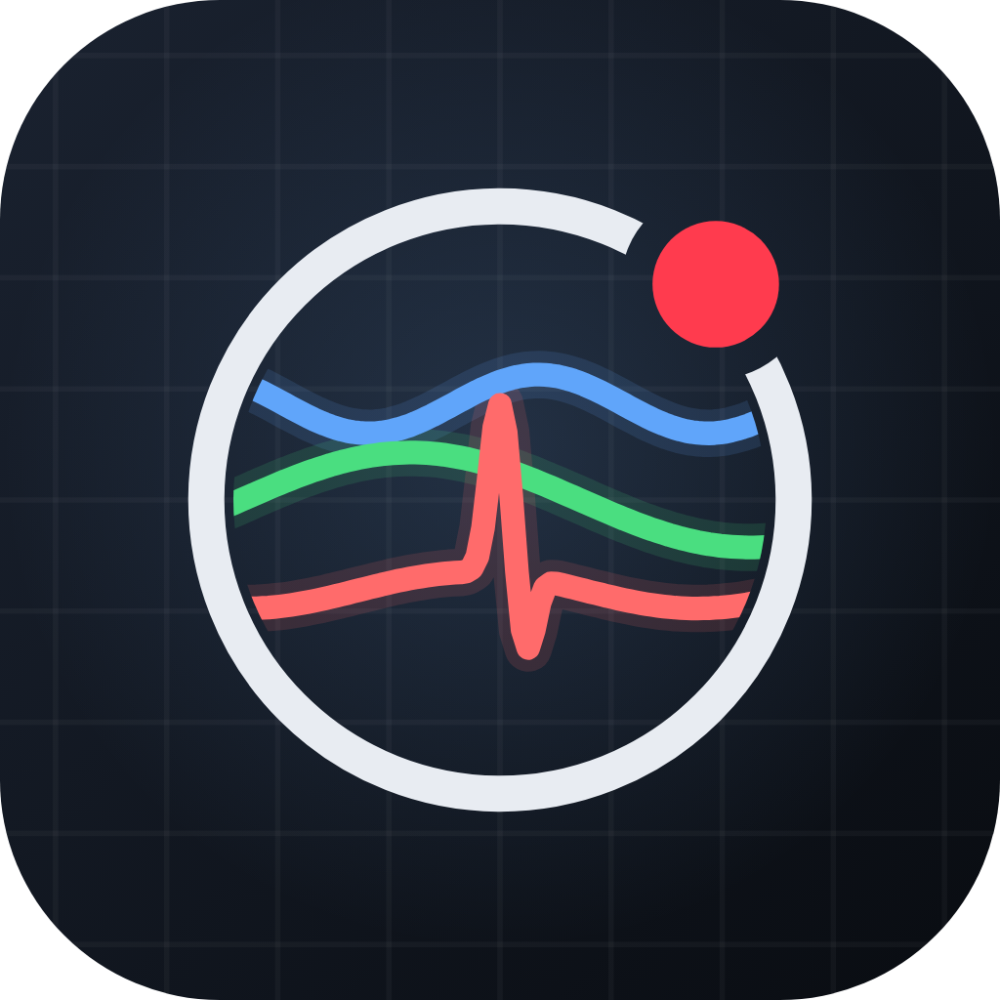

<p align="center"></p>

# SensorFlow Accelerometer

Records video together with synchronized accelerometer data for dataset collection.

## Output

| File | Location | Content |
| --- | --- | --- |
| `video_<id>.mp4` | Gallery (falls back to `Download/`) | Camera recording |
| `sensors_<id>.csv` | `Download/` | `timestamp_ms,x,y,z` (m/s², wall-clock milliseconds) |

## Features

- Live scrolling X / Y / Z chart with auto-scaling and current-value tags
- Per-axis toggles, measured sampling rate, sample counter and timer
- Capture settings: video resolution (480p default) and sampling rate (UI ~15 Hz default)
- Screen stays awake; recording is finalized safely when the app goes to background

## Project layout

```
lib/
  main.dart
  models/      accelerometer_sample, capture_settings, sensor_axis
  services/    dataset_storage, permission_service, csv_encoder, sample_ring_buffer, monotonic_clock
  widgets/     live_axis_chart, axis_value_tile, record_button, recording_badge, settings_sheet, status_views
  screens/     recorder_screen
  theme/       app_theme
```

## App icon

Source files are in `branding/`: adaptive icon layers as SVG, a 1024 px master and a 512 px Play Store icon. Generated launcher assets live in `android/app/src/main/res/mipmap-*`.
